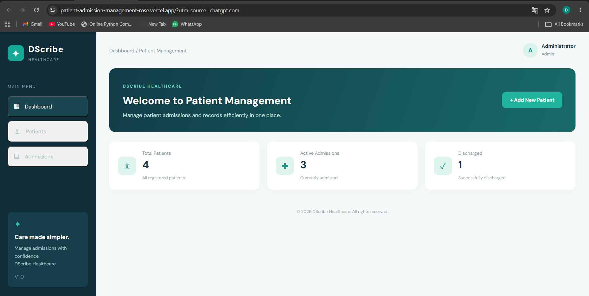
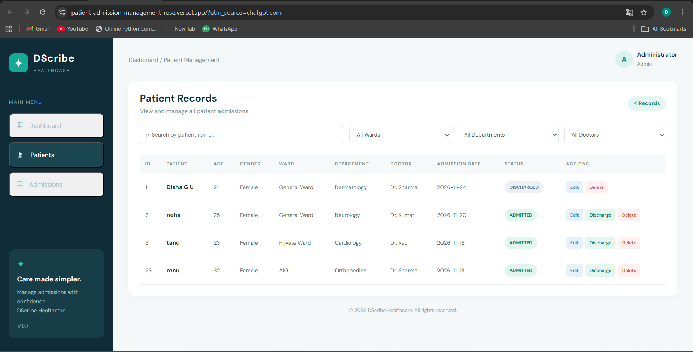
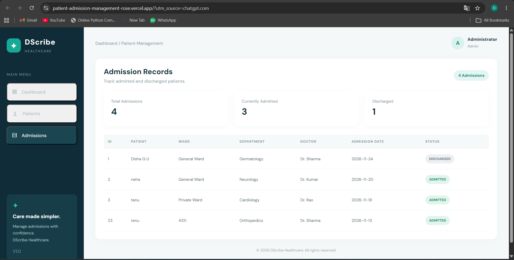

# Patient Admission Management System

A web-based Patient Admission Management System built using React.js, Java Spring Boot, and MySQL. It helps manage patient admission records through a simple and responsive dashboard.

## Technologies Used

**Frontend**
- React.js
- HTML5
- CSS3
- JavaScript
- Vite

**Backend**
- Java 17
- Spring Boot
- Spring Data JPA
- Hibernate
- Maven

**Database**
- MySQL

**API Testing**
- Postman

## Features

- Add new patient records
- View all patient records
- Search patients by name
- Filter patients by ward, department, and doctor
- Edit patient details
- Delete patient records with confirmation
- Mark patients as discharged
- Dashboard with patient statistics
- Form validation
- Responsive user interface

## Patient Information

The application manages the following details:

- Patient ID
- Name
- Age
- Gender
- Ward
- Department
- Doctor
- Admission Date
- Admission Status

## Project Structure

```text
patient-admission-management/
│
├── backend/
│   ├── src/
│   ├── pom.xml
│   └── mvnw
│
├── frontend/
│   ├── public/
│   ├── src/
│   ├── package.json
│   └── vite.config.js
│
└── .gitignore
```

## Setup and Installation

### Prerequisites

- Java 17 or later
- Node.js and npm
- MySQL
- Git

### 1. Clone the Repository

```bash
git clone https://github.com/4JN22CS040/patient-admission-management.git
cd patient-admission-management
```

### 2. Configure the Database

Create a MySQL database:

```sql
CREATE DATABASE patient_managements;
```

Configure the database connection using environment variables:

- DB_URL
- DB_USERNAME
- DB_PASSWORD

Do not commit database passwords or other credentials to GitHub.

### 3. Run the Backend

Open a terminal:

```bash
cd backend
```

Run:

```bash
.\mvnw.cmd spring-boot:run
```

The backend runs on:

`http://localhost:8080`

### 4. Run the Frontend

Open another terminal:

```bash
cd frontend
```

Install dependencies:

```bash
npm install
```

Start the application:

```bash
npm run dev
```

Open:

`http://localhost:5173`

## API Endpoints

| Method | Endpoint | Description |
|---|---|---|
| GET | /api/patients | View all patients |
| GET | /api/patients/{id} | View patient by ID |
| POST | /api/patients | Add a patient |
| PUT | /api/patients/{id} | Update patient details |
| DELETE | /api/patients/{id} | Delete a patient |
| PATCH | /api/patients/{id}/discharge | Mark patient as discharged |

## Validation

The application validates patient information, including:

- Required fields
- Alphabetic patient names
- Age between 0 and 120
- Valid gender, ward, department, and doctor selections
- Admission date cannot be in the future

Backend validation is also implemented to reject invalid data.

## Live Application

Frontend: https://patient-admission-management-rose.vercel.app

Backend API: https://patient-admission-management-pc3h.onrender.com/api/patients

## Application Screenshots

### 1. Dashboard


### 2. Patient Records


### 3. Admissions


## Author

Disha G U

B.Tech – 2026
